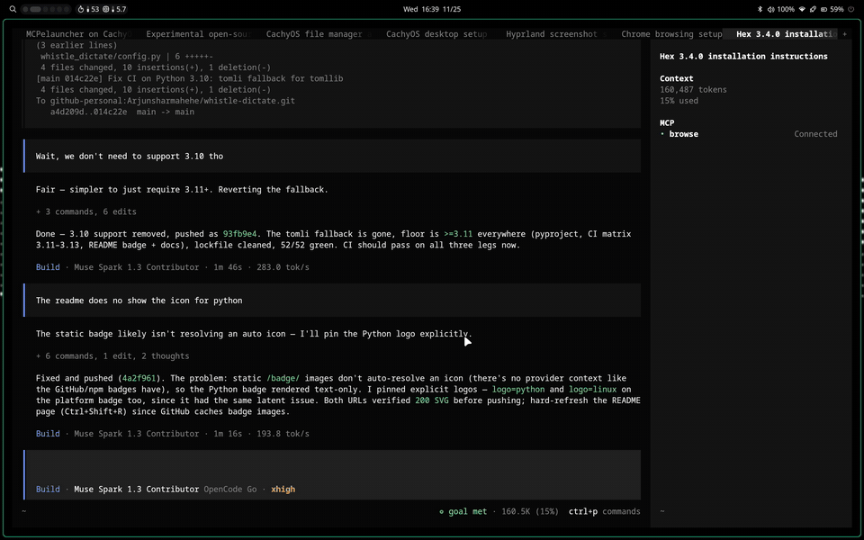

<p align="center">
  <picture>
    <source media="(prefers-color-scheme: dark)" srcset="https://shieldcn.dev/header/gradient.svg?title=whistle-dictate&subtitle=Local+voice+dictation+for+Hyprland+with+Cactus+Whistle&align=center&mode=dark" />
    
  </picture>
</p>

<p align="center">
  <a href="https://github.com/Arjunsharmahehe/whistle-dictate"></a>
  <a href="https://github.com/Arjunsharmahehe/whistle-dictate/actions"></a>
  <a href="https://github.com/Arjunsharmahehe/whistle-dictate/commits/main"></a>
  <a href="https://www.python.org/downloads/"></a>
  <a href="https://hyprland.org"></a>
  <a href="https://github.com/Arjunsharmahehe/whistle-dictate/blob/main/LICENSE"></a>
</p>

<p align="center"><em>Press a hotkey, speak, press again. Your words appear at the cursor. Nothing leaves your machine.</em></p>

<p align="center">
  
</p>

**whistle-dictate** is Hex-like local voice dictation for Hyprland, in Python. It uses [Cactus Whistle](https://cactuscompute.com/blog/whistle), a 16.9 MB on-device model (en/de/fr/es/it/nl/pl), with a live glass recording card, a global toggle hotkey, and paste at cursor. Inspired by [anomalyco/hex](https://github.com/anomalyco/hex). Hex only loads GGUF Parakeet/Whisper models via `transcribe.cpp`, while Whistle is a `.cact` for the Cactus engine, so this project exists.

## Contents

- [Where it works](#where-it-works)
- [Quickstart](#quickstart)
- [Hyprland binds](#hyprland-binds)
- [Usage](#usage)
- [Config](#config)
- [Backends](#backends)
- [Troubleshooting](#troubleshooting)
- [Tests](#tests)
- [Roadmap](#roadmap)
- [Contributing](#contributing)
- [License](#license)

## Where it works

| Environment | Status | Notes |
|---|---|---|
| Hyprland 0.57+ (Wayland, Linux) | ✅ Supported | Toggle binds, `wtype` typing, GTK glass card, Noctalia OSD |
| Other Wayland compositors | 🟡 Untested | `wtype` + `wl-copy` path is compositor agnostic |
| X11 / macOS / Windows | 🔲 Roadmap | Backend seams exist; contributions welcome |

Paste order on Linux: `wtype` (direct typing) then `wl-copy` + `hyprctl sendshortcut CTRL,V` (terminals get `CTRL_SHIFT,V`). If the keystroke never lands, the text stays in your clipboard with a nudge to press `Ctrl+V`.

## Quickstart

Requirements: Arch/Hyprland, Python 3.11+ via [uv](https://docs.astral.sh/uv/), PipeWire mic.

```bash
yay -S wtype wl-clipboard
/usr/bin/python3 -c "import gi, cairo; print('overlay deps ok')"  # Arch: python-gobject gtk3 python-cairo

git clone https://github.com/Arjunsharmahehe/whistle-dictate.git
cd whistle-dictate
uv sync
uv run whistle-dictate mic-test      # speak, bars should move
uv run whistle-dictate warm          # download whistle.cact once (~16.9 MB)
uv run whistle-dictate listen --duration 5   # end to end, no binds needed
```

Then wire the hotkey ([below](#hyprland-binds)): press it, speak, press again. Text appears at the cursor.

Step by step with expected outputs: [`docs/SETUP.md`](docs/SETUP.md).

## Hyprland binds

Toggle is recommended. Hyprland 0.57 Lua has no `bindr` hold to talk, and Hex docs agree release timing is unreliable with modifiers.

```ini
bind = ALT, Space, exec, ~/.local/bin/whistle-dictate toggle
bind = CTRL, Space, exec, ~/.local/bin/whistle-dictate toggle
bind = , End, exec, ~/.local/bin/whistle-dictate toggle

windowrule = float, title:^(wd-osd.*)$
windowrule = nofocus, title:^(wd-osd.*)$
```

Lua equivalent: `hl.bind("ALT + Space", hl.dsp.exec_cmd(WD .. " toggle"))`, plus `hl.exec_cmd(WD .. " warm")` at login so the first dictation is instant. Full example: [`hyprland.conf.example`](hyprland.conf.example).

Prefer keys without Alt where possible. Alt leaks to Electron apps and steals focus. Never hold modifiers during paste.

## Usage

```bash
whistle-dictate toggle                # one key: start, then stop+paste
whistle-dictate start                 # begin recording
whistle-dictate stop                  # stop + transcribe + paste
whistle-dictate stop --print          # print instead of only pasting
whistle-dictate cancel                # discard recording
whistle-dictate listen --duration 5   # blocking test (no binds needed)
whistle-dictate transcribe clip.wav [--words --json]
whistle-dictate status [--json]
whistle-dictate history [--limit 20]
whistle-dictate paste-last
whistle-dictate devices               # list mic devices
whistle-dictate mic-test              # live level meter
```

While recording, a top center glass card shows a pulsing dot, a live timer, and a 24 band spectrum. On stop it sweeps to transcribing, then fades. Pasted text is the confirmation. Errors and silence get a short card. Nothing steals focus and clicks pass through.

## Config

`~/.config/whistle-dictate/config.toml` (auto seeded on first run, see `config.example.toml`):

```toml
# language = "en"   # None = auto-detect (en/de/fr/es/it/nl/pl)
# keywords = ["Siobhan", "Krzysztof"]  # vocabulary biasing
# paste_method = "auto"  # auto | hyprland | wtype | clipboard | stdout
# transcriber = "whistle"
# audio_source = "sounddevice"
# notifier = "auto"  # auto | noctalia | noop
# overlay = true     # false = headless, saves ~65 MB
# mic = null  # sounddevice index or name substring (see `devices`)
# sensitivity = 1.0  # spectrum gate strictness, 0.3..3.0
```

History lives in `~/.local/share/whistle-dictate/history.jsonl` (private, outside the repo). Ephemeral state in `$XDG_RUNTIME_DIR/whistle-dictate/`. Paste debug log at `~/.local/share/whistle-dictate/paste-debug.log`.

## Backends

Same flow on every OS, different backends. Only Hyprland/Linux is fully wired. Adding a platform is one file implementing the 2 to 4 method `Protocol` plus one factory line. `status --json` shows the resolved platform and backends.

| Surface | Today | Future |
|---|---|---|
| Transcription (`transcribers/`) | `whistle` (16.9 MB `.cact`) | whisper, macOS Speech, Windows SAPI |
| Audio (`audio_sources/`) | `sounddevice` | coreaudio, wasapi |
| Paste (`paste_backends/`) | `hyprland` (wtype, wl-copy+hyprctl) | `pbcopy`+osascript, `clip`+SendKeys |
| Overlay (`overlays/`) | `gtk` on Linux, `noop` elsewhere | aqua/windows native card |
| Notify (`notifiers/`) | `noctalia` on Hyprland, `noop` elsewhere | notification center, toast |

Details: [`docs/ARCHITECTURE.md`](docs/ARCHITECTURE.md). Benchmarks (upstream): 11 ms TTFT, 1319 tok/s, 10 s audio on M4 Pro, vs Whisper base 73 ms / 266 tok/s at 145 MB.

## Troubleshooting

| Symptom | Fix |
|---|---|
| `mic-test` flat | `wpctl status`, unmute and pick input; then pin it with `mic = "<name>"` (see `devices`) |
| "press Ctrl+V" card | Compositor blocked the keystroke. Text is in the clipboard, press `Ctrl+V` (`Ctrl+Shift+V` in terminals) |
| No overlay card | `overlay = false` is set, or system python lacks `gi`/`cairo`. Headless mode still pastes |
| First run slow | Run `whistle-dictate warm` to download `whistle.cact` once |
| `already recording` stuck | `whistle-dictate cancel`, then `status` shows `"recording": false` |
| `status` shows engine `not installed` | `uv sync` |

## Tests

```bash
uv run python -m unittest discover -s tests -t .   # 52 tests, no mic/model/Hyprland needed
```

Stub engines and mocked subprocess throughout. Live smoke before pushing: `status`, file `transcribe`, `start` then `stop --print`, overlay reaps cleanly.

## Roadmap

- [ ] Publish to PyPI / `uv tool install`
- [x] CI (stdlib unittest matrix, 3.11 to 3.13)
- [ ] CI hardening (ruff + mypy)
- [ ] Sway/river smoke reports
- [ ] macOS / Windows paste + notifier backends
- [ ] Whisper transcriber behind the same protocol

## Contributing

PRs welcome, especially new backends. See [`CONTRIBUTING.md`](CONTRIBUTING.md) for setup, the test loop, and the 20 line backend recipe.

## Privacy

<a id="privacy"></a>

All transcription is on device. After the one time `whistle.cact` download, no audio or text leaves your machine.

## License

MIT, see [LICENSE](LICENSE). Thanks to [Cactus Whistle](https://cactuscompute.com/blog/whistle) for the tiny model and [anomalyco/hex](https://github.com/anomalyco/hex) for the interaction design.
